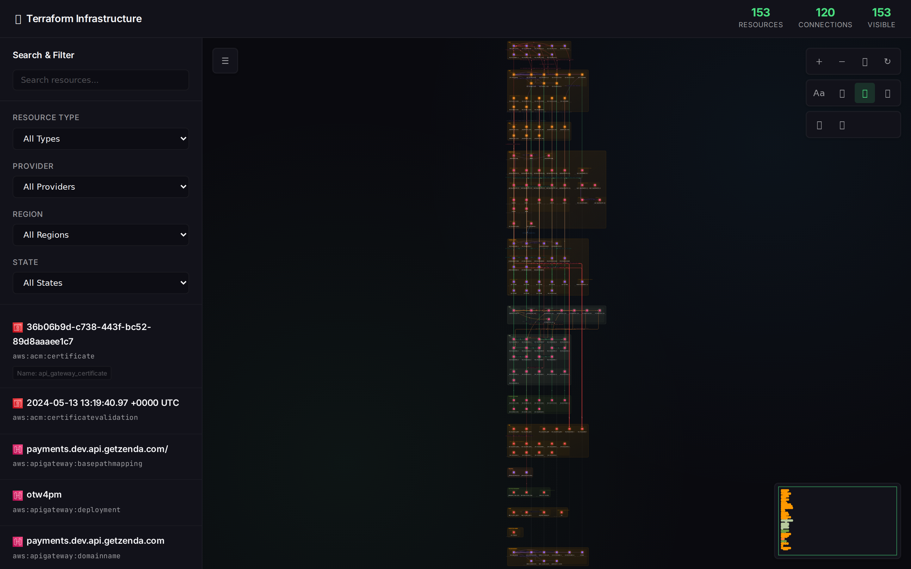
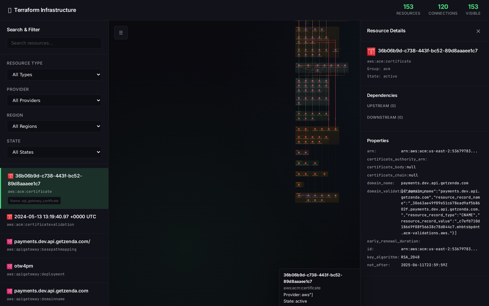

# TerraViz: Open Source Terraform Visualizer and AWS Architecture Diagram Tool

[](https://github.com/krishnaduttPanchagnula/TerraViz/releases/latest)
[](https://go.dev/)
[](LICENSE)

TerraViz is an open source **Terraform visualizer** and **AWS architecture diagram generator**. It converts Terraform state files, `terraform show -json` output, S3-hosted Terraform state, and live AWS resources into interactive infrastructure diagrams in your browser.

Use TerraViz to understand an unfamiliar Terraform project, explore AWS resource relationships, document cloud infrastructure, find referenced resources that are missing from state, and export architecture data as PNG, SVG, or CSV. The Go binary embeds the web application and AWS icon set, so no Node.js application or external database is required.



## Why TerraViz?

- **Visualize Terraform state:** Turn raw `.tfstate` and Terraform JSON output into a readable resource graph.
- **Generate AWS architecture diagrams:** See VPC, subnet, security group, EC2, Lambda, S3, RDS, CloudFront, API Gateway, IAM, ECS, and other relationships.
- **Find external dependencies:** Referenced AWS resources missing from the state file appear as inferred nodes with relationship lines.
- **Inspect infrastructure locally:** State data is processed by the TerraViz server you run, with no hosted SaaS account required.
- **Explore large diagrams:** Search, filter, zoom, pan, use the minimap, or switch to a complete resource list.
- **Export and compare:** Download PNG, SVG, or CSV output and compare two generated scan snapshots from the CLI.

## Contents

- [Installation](#installation)
- [Quick Start](#quick-start)
- [Terraform Visualization](#terraform-visualization)
- [AWS Architecture Visualization](#aws-architecture-visualization)
- [Features](#features)
- [CLI Reference](#cli-reference)
- [Supported Providers and Services](#supported-providers-and-services)
- [FAQ](#frequently-asked-questions)
- [Development](#development)

## Installation

### Homebrew (macOS / Linux)

```bash
brew install krishnaduttPanchagnula/TerraViz/terraviz
```

The formula is automatically updated on every release.

### Download a Release

Download the latest binary for your platform from the [Releases page](https://github.com/krishnaduttPanchagnula/TerraViz/releases/latest).

```bash
# Linux (amd64)
curl -Lo terraviz.tar.gz \
  https://github.com/krishnaduttPanchagnula/TerraViz/releases/latest/download/terraviz_$(curl -s https://api.github.com/repos/krishnaduttPanchagnula/TerraViz/releases/latest | grep tag_name | cut -d '"' -f4 | sed 's/^v//')_linux_amd64.tar.gz
tar xzf terraviz.tar.gz
chmod +x terraviz
sudo mv terraviz /usr/local/bin/

# macOS (Apple Silicon)
curl -Lo terraviz.tar.gz \
  https://github.com/krishnaduttPanchagnula/TerraViz/releases/latest/download/terraviz_$(curl -s https://api.github.com/repos/krishnaduttPanchagnula/TerraViz/releases/latest | grep tag_name | cut -d '"' -f4 | sed 's/^v//')_darwin_arm64.tar.gz
tar xzf terraviz.tar.gz
chmod +x terraviz
sudo mv terraviz /usr/local/bin/
```

### Build from Source

```bash
git clone https://github.com/krishnaduttPanchagnula/TerraViz.git
cd TerraViz
go build -o terraviz ./cmd/main.go
```

To embed version info:

```bash
go build -ldflags "-s -w -X main.version=1.0.0 -X main.commit=$(git rev-parse HEAD) -X main.date=$(date -u +%Y-%m-%dT%H:%M:%SZ)" \
  -o terraviz ./cmd/main.go
```

## Quick Start

```bash
# Scan a Terraform state file
terraviz scan terraform terraform.tfstate

# Serve the diagram
terraviz serve diagram.json

# Or start the server without a diagram and import from S3 or local file
terraviz serve

# Open the Terraform architecture diagram in your browser
open http://localhost:8080
```

TerraViz serves the interactive diagram at `http://localhost:8080` by default.

## Terraform Visualization

TerraViz parses Terraform state without requiring access to the original HCL source code. It supports:

- Raw Terraform state format version 4 (`terraform.tfstate`).
- State JSON produced by `terraform show -json`.
- Local state uploads through the browser.
- Remote Terraform state stored in Amazon S3.
- Nested Terraform module addresses and indexed resources.
- Inferred AWS dependencies from IDs, ARNs, and recognized resource arguments.

Terraform resources are grouped by AWS service and resource type. Connections are inferred from attributes such as `vpc_id`, `subnet_id`, security group IDs, IAM role ARNs, target group ARNs, SQS/SNS endpoints, and CloudFront ACM certificate references.

## AWS Architecture Visualization

TerraViz can also scan supported resources from a live AWS account using the standard AWS SDK credential chain and an optional named profile. The current live scanner discovers EC2 instances, VPCs, subnets, security groups, S3 buckets, RDS database instances, and Lambda functions across configured regions.

For broader AWS service coverage, load a Terraform state file. See [Supported Providers and Services](#supported-providers-and-services) for the complete Terraform resource list.

## Screenshots

### Interactive Terraform and AWS Diagram
Explore Terraform resources and AWS dependencies with zoom, pan, filtering, search, and hierarchical service containers.


### Resource Details
Click any resource to see its properties, connections, and metadata.



## Features

### Input Sources
- **Terraform State Files** — Parse `.tfstate` (v4 raw format) or `terraform show -json` output
- **S3 Remote State** — Browse S3 buckets and load remote `.tfstate` files directly from the UI (supports custom AWS profiles)
- **Local File Import** — Upload `.tfstate` files from your machine via drag-and-drop or file picker
- **Live AWS Account** — Scan EC2 instances, S3 buckets, RDS instances, Lambda functions, VPCs, subnets, and security groups across multiple regions

### Interactive Web Diagrams
- SVG-based rendering with zoom, pan, and fit-to-view
- **Floating toolbar** — zoom, grid, labels, minimap, flow animation, legend, export, presentation, and display settings
- Filter by resource type, provider, region, or state
- Real-time search by resource name or ID
- Toggle between the architecture diagram and a full resource table
- Show referenced AWS resources that are not managed in the loaded Terraform state
- Export architecture diagrams as PNG or SVG and all resource data as CSV
- Hide/show individual resources; add or delete connections at runtime
- Hover tooltips with resource details
- **Resizable sidebar** with collapsible sections (Search & Filter, Files, Filters, Resources) and vertical scrolling
- **Connection legend** — popover showing all 6 connection type colors
- Browser UI served at `/` with REST endpoints under `/api/`

### Themes and Design
- Dark, Aurora, Light, and Sand themes with browser-persisted settings
- Dot-grid architecture canvas with hierarchical service and resource-type containers
- Geist + JetBrains Mono typography with systematized design tokens (spacing, shadows, motion, radius)
- Animated expand/collapse sidebar sections with smooth CSS transitions
- Button micro-interactions (hover glow, active scale)

### Infrastructure Comparison
- Compare two scan results to see added, removed, and modified resources
- Connection diffs (added/removed)
- Detailed per-property change reports with `--verbose`

### Common Use Cases

- Generate a Terraform infrastructure diagram for architecture reviews.
- Visualize relationships in a large or inherited Terraform state file.
- Document AWS infrastructure without manually drawing every resource.
- Review dependencies before refactoring Terraform modules.
- Identify subnets, security groups, certificates, queues, and other references missing from the loaded state.
- Export an AWS resource inventory to CSV for audits or documentation.
- Compare infrastructure scan snapshots between deployments.

### Portable Go Binary
- `go build` produces a single binary (~47 MB) with all HTML templates, JavaScript, fonts, and ~620 AWS icons embedded via `go:embed`
- No Node.js runtime or external database is required
- Download and run on Linux, macOS, or Windows

## CLI Reference

### Global Flags
| Flag | Short | Default | Description |
|------|-------|---------|-------------|
| `--output` | `-o` | `diagram.json` | Output file path |
| `--verbose` | `-v` | `false` | Verbose output |
| `--version` | | | Print version, commit, and build date |

### `scan terraform <state-file>`
Parses a Terraform state file. Supports both raw `.tfstate` (v4) and `terraform show -json` format. Auto-detects which format based on whether the JSON contains `format_version`.

### `scan aws`
Scans a live AWS account using the AWS SDK.

| Flag | Short | Default | Description |
|------|-------|---------|-------------|
| `--regions` | `-r` | `us-east-1` | Comma-separated AWS regions |
| `--profile` | `-p` | (default) | AWS credentials profile |

**Required IAM permissions:** `ec2:Describe*`, `s3:ListAllMyBuckets`, `s3:GetBucketLocation`, `rds:DescribeDBInstances`, `lambda:ListFunctions`, `elbv2:DescribeLoadBalancers`, `iam:ListRoles`, `iam:ListUsers`

### `compare <scan1.json> <scan2.json>`
Compares two scan result JSON files and outputs a comparison JSON. With `--verbose`, prints per-resource property diffs to stdout.

### `serve [diagram.json]`
Starts a local web server to display the interactive diagram. The diagram argument is optional — when omitted, the server starts with an empty canvas and you can import state files from S3 or your local machine via the UI.

| Flag | Short | Default | Description |
|------|-------|---------|-------------|
| `--port` | `-P` | `8080` | Port to bind |
| `--host` | `-H` | `localhost` | Host to bind |

**Routes:**
- `GET /` — Interactive Terraform and AWS architecture diagram
- `GET /api/diagram` — Full diagram JSON
- `GET /api/resources` — All resources
- `GET /api/resources/search?q=<query>` — Search resources
- `GET /api/resources/filter?type=&provider=&region=&state=&tag=` — Filter resources
- `POST /api/resources/:id/hide` — Hide a resource
- `POST /api/resources/:id/show` — Show a resource
- `GET /api/connections` — All connections
- `POST /api/connections` — Create a connection
- `DELETE /api/connections/:id` — Delete a connection
- `GET /api/stats` — Diagram statistics
- `POST /api/export/:format` — Export (json supported; svg/png handled client-side)
- `GET /api/s3/buckets?profile=` — List S3 buckets (optional AWS profile)
- `GET /api/s3/objects?bucket=&prefix=&profile=` — List objects in an S3 bucket
- `POST /api/s3/load` — Load a `.tfstate` file from S3 and render it
- `POST /api/upload` — Upload a local `.tfstate` file (multipart form)

## Supported Providers and Services

<details>
<summary><strong>List of providers/services</strong></summary>

<details>
<summary><strong>AWS</strong></summary>

- **Amazon API Gateway:** REST APIs, resources, methods, integrations, method responses, integration responses, deployments, stages, domain names, base path mappings, usage plans, and VPC links
- **AWS Certificate Manager (ACM):** Certificates and certificate validations
- **Amazon CloudFront:** Distributions
- **Amazon CloudWatch Logs:** Log groups
- **AWS Cloud Map:** Private DNS namespaces and services
- **Amazon EC2:** Instances
- **Amazon Elastic Container Registry (ECR):** Repositories
- **Amazon Elastic Container Service (ECS):** Clusters, services, and task definitions
- **Elastic Load Balancing (ELB):** Classic load balancers, Application/Network Load Balancers, listeners, listener rules, target groups, and target group attachments
- **AWS Identity and Access Management (IAM):** Roles, users, policies, and role-policy attachments
- **AWS Key Management Service (KMS):** Keys
- **AWS Lambda:** Functions
- **Amazon Relational Database Service (RDS):** Database instances
- **Amazon Route 53:** Hosted zones and records
- **Amazon Simple Notification Service (SNS):** Topics, subscriptions, and topic policies
- **Amazon Simple Queue Service (SQS):** Queues and queue policies
- **Amazon Simple Storage Service (S3):** Buckets
- **AWS Secrets Manager:** Secrets
- **Amazon VPC:** VPCs, subnets, and security groups
- **AWS WAF:** Web ACLs, IP sets, and web ACL associations

Terraform state parsing supports all resources listed above. Live AWS account scanning currently covers EC2 instances, VPCs, subnets, security groups, S3 buckets, RDS instances, and Lambda functions.

</details>

</details>

## Connection Types

Connections between resources are automatically inferred from Terraform state attributes (e.g., `vpc_id`, `subnet_id`, security group references, IAM role ARNs, target group attachments, SNS/SQS subscriptions).

| Type | Description |
|------|-------------|
| `networking` | Network-level (VPC, subnet, security group) |
| `access` | Security and permission relationships |
| `data` | Data flow connections |
| `trigger` | Event-driven connections |
| `dependency` | Resource dependencies |
| `reference` | Logical references |

## Frequently Asked Questions

### What is a Terraform visualizer?

A Terraform visualizer converts Terraform state or plan data into a graph of infrastructure resources and their relationships. TerraViz reads raw `.tfstate` files and `terraform show -json` state output, then renders an interactive browser-based architecture diagram.

### Does TerraViz upload Terraform state to a hosted service?

No hosted TerraViz service is required. The CLI starts a local Gin web server and processes local or S3-hosted Terraform state in that server process. Review your own network and AWS credential configuration before exposing the server beyond localhost.

### Can TerraViz create an AWS architecture diagram from Terraform state?

Yes. TerraViz maps supported AWS Terraform resource types to AWS service icons, groups them into hierarchical containers, and infers networking, access, data, trigger, dependency, and reference relationships.

### Does TerraViz support `terraform show -json`?

Yes. TerraViz accepts both raw Terraform state version 4 and state JSON generated with `terraform show -json`. Full Terraform plan action visualization is not currently supported.

### Can TerraViz scan a live AWS account?

Yes. The live scanner currently discovers EC2 instances, VPCs, subnets, security groups, S3 buckets, RDS instances, and Lambda functions. Terraform state parsing supports a broader set of AWS services.

### Which diagram export formats are supported?

The browser can export diagrams as PNG or SVG and resource information as CSV. The CLI writes scan and comparison results as JSON.

### Does TerraViz support Azure or Google Cloud?

Not yet. The current implementation supports AWS. The planned provider-interface architecture for Azure and Google Cloud is documented in [`docs/gcp_azure_implementation.md`](docs/gcp_azure_implementation.md).

### How are resources not present in Terraform state displayed?

When a recognized Terraform argument references an AWS ID or ARN that is absent from the state, TerraViz creates an inferred resource marked `in_state_file: false` and draws the detected relationship. State files do not retain every original HCL expression, so inference is limited to recognized typed arguments.

## Project Structure

```
cmd/
  main.go                  CLI entry point (Cobra commands)
internal/
  models/
    models.go              Resource, Connection, Diagram, ScanResult types; icon map
    utils.go               DiagramBuilder, comparison logic, search/filter, FNV ID generation
  parsers/
    terraform.go           Terraform state parser (raw v4 + terraform-json)
    connections.go         Connection inference analyzers
  scanners/
    aws.go                 Live AWS account scanner (EC2, S3, RDS, Lambda)
  server/
    server.go              Gin HTTP server, REST API, mutex-protected state
web/
  embed.go                 go:embed directive (embeds all assets into binary)
  templates/               Go HTML templates (index_enhanced.html, error.html)
  static/
    js/                    Frontend JavaScript (diagram_enhanced.js)
    fonts/                 Bundled Inter + JetBrains Mono fonts (WOFF2)
  icons/                   Full AWS icon packs (~620 SVGs)
.goreleaser.yml            GoReleaser config for multi-platform releases
.github/workflows/         CI/CD (release on tag push)
```

## Releasing

Releases are automated via GitHub Actions and [GoReleaser](https://goreleaser.com/).

```bash
# Generate notes, validate, tag, and trigger a release
./scripts/release.sh v1.0.0
```

This builds binaries for Linux, macOS, and Windows (amd64 + arm64), creates a GitHub release with checksums and changelogs, and updates the Homebrew formula automatically.

## Development

```bash
# Install dependencies
go mod download

# Build
go build -o terraviz ./cmd/main.go

# Vet
go vet ./...

# Run with sample data
terraviz scan terraform payments-state.tfstate --output diagram.json
terraviz serve diagram.json --port 8081
```

## Key Dependencies

| Package | Purpose |
|---------|---------|
| `github.com/spf13/cobra` | CLI framework |
| `github.com/gin-gonic/gin` | HTTP server |
| `github.com/hashicorp/terraform-json` | Terraform state parsing |
| `github.com/aws/aws-sdk-go-v2` | AWS API access (EC2, S3, RDS, Lambda) |
| `github.com/charmbracelet/lipgloss` | Terminal styling |

## License

MIT
