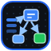
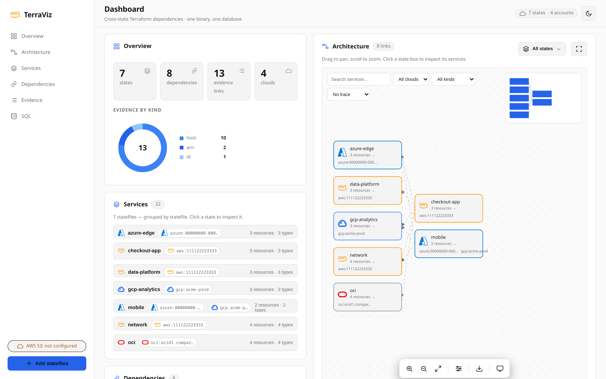
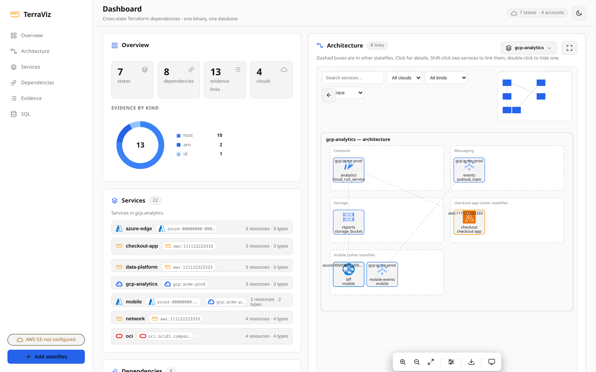
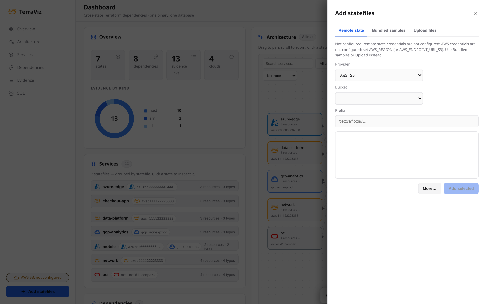
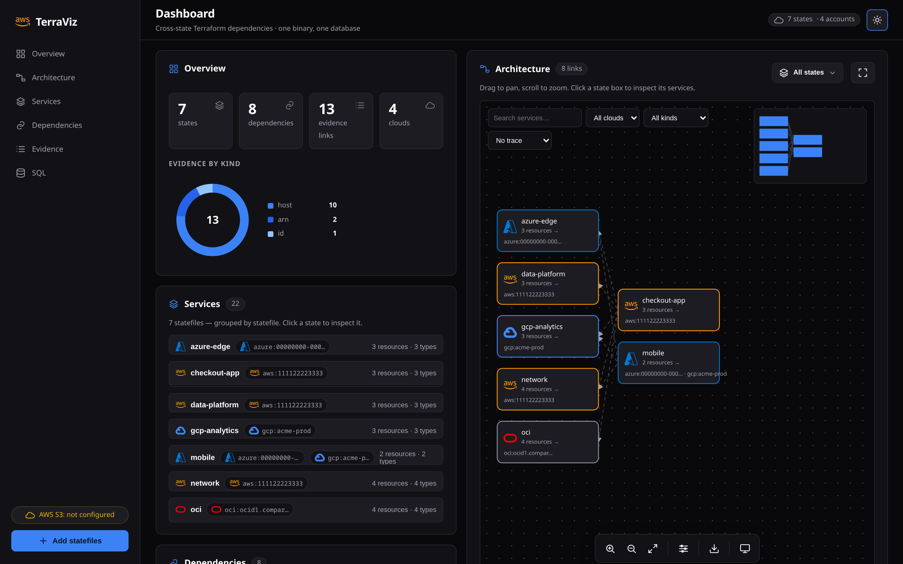

<p align="center">
  
</p>

# TerraViz

[](https://github.com/krishnaduttPanchagnula/TerraViz/releases/latest)
[](https://go.dev/)
[](LICENSE)

**TerraViz turns Terraform and OpenTofu statefiles into a queryable, visual map
of your infrastructure — across apps, clouds and accounts — in a single Go
binary.**

Ingest statefiles from your machine, S3, GCS, Azure Blob or OCI Object Storage.
TerraViz infers which app depends on which other app from shared ARNs, hosts,
IDs and names, stores the result in embedded SQLite, and lets you explore it
with read-only SQL and an interactive architecture diagram. It also scans live
AWS accounts and exports diagrams to SVG, PNG, CSV, Mermaid and DOT.

- **Cross-state dependency resolution** — evidence-backed edges between
  statefiles, rolled up into app-level dependencies.
- **Account-aware architecture** — AWS accounts, GCP projects, Azure
  subscriptions and OCI compartments are detected and shown as badges and
  filters.
- **Rich single-page dashboard** — dotted pannable/zoomable canvas, minimap,
  search, multi-hop trace, view options and light/dark themes.
- **No runtime dependencies** — the UI, fonts and official AWS/GCP/Azure icons
  are embedded; no Node.js, external database or CDN.

## Screenshots

| Dashboard | Architecture drill-down |
|-----------|-------------------------|
|  |  |

| Remote state sources | Dark theme |
|----------------------|------------|
|  |  |

## Install

```bash
brew install krishnaduttPanchagnula/TerraViz/terraviz
# or: go install github.com/krishnaduttPanchagnula/TerraViz@latest
# or: go build -o terraviz .
```

## Quick start

```bash
# Dashboard: multi-state dependencies, SQL, samples
terraviz -serve -addr :8080 -db terraviz.db
# open http://localhost:8080 → "+ Add statefiles" → "Bundled samples"
# click a state to see its resources and use the floating canvas toolbar

# One-shot cross-state analysis
terraviz -v -db terraviz.db network=network.tfstate app=app.tfstate

# Read-only SQL
terraviz -db terraviz.db -query "SELECT * FROM dependencies"
```

## CLI

The original terraquery-style flags work at the root:

```
terraviz [-min 0.5] [-v] [-json out.json] [-db terraviz.db] [name=]state.tfstate ...
terraviz -serve [-addr :8080] [-db terraviz.db]
terraviz -query "SELECT ..." [-db terraviz.db]
```

TerraViz's subcommands are preserved:

```
terraviz scan terraform state.tfstate [-o diagram.json]
terraviz scan aws [--regions us-east-1,us-west-2] [--profile default]
terraviz compare before.json after.json
terraviz export diagram.json --format svg|png|csv|mermaid|dot|drawio|html|md
terraviz serve [diagram.json] [-addr :8080] [-db terraviz.db]
```

## Dashboard UI

The dashboard design follows terraquery with a minimal zinc + blue palette
(modelled on the shadcn CRM dashboard). Dark/light toggle lives in the top bar;
light is the default. Layout: left nav rail, top bar, and a split workspace —
left column for overview, services, dependencies, evidence and SQL; right
column for a tall sticky, pannable/zoomable architecture canvas.

- Add statefiles from **S3**, **bundled multi-cloud samples** or local upload.
- State dropdown groups states by **AWS account / GCP project / Azure
  subscription**, with checkboxes to show/hide whole accounts or individual
  states.
- Click a state box to drill into its architecture; the back icon in the
  canvas returns to all states. Enlarge moves the live canvas full-screen.
- **Services** are grouped by statefile; resource types use the embedded AWS
  icon set.
- **SQL box** for arbitrary read-only queries.

The dashboard canvas uses TerraViz's floating toolbar and dotted background,
and carries its detailed tools: search, cloud/evidence-kind
filters, view options (dot grid, labels, flow animation, minimap, legend,
simplified view), multi-hop trace, presentation mode, SVG/PNG/CSV/Mermaid/DOT
export, double-click to hide a resource, and Shift-click two services to add a
custom connection.

### Remote state configuration

The **Remote state** tab supports AWS S3, Google Cloud Storage, Azure Blob
Storage and OCI Object Storage. Each provider uses its own standard credential
chain:

| Provider | Required configuration |
|----------|------------------------|
| AWS | `AWS_REGION` + AWS credentials; `AWS_ENDPOINT_URL_S3` for emulators |
| GCP | `GOOGLE_CLOUD_PROJECT` + application-default credentials |
| Azure | `AZURE_STORAGE_ACCOUNT` (or `AZURE_STORAGE_ENDPOINT`) + Azure default credentials |
| OCI | `OCI_COMPARTMENT_ID` (or tenancy OCID) + `~/.oci/config` |

Missing credentials are reported in the UI with the exact variable to set.
The legacy `/api/s3/*` endpoints remain as AWS-only aliases.

## HTTP API

Dashboard API at `/api/...` (see the source for the full list): `health`,
`states`, `resources`, `deps`, `edges`, `graph`, `query` (read-only SQL),
`remote/*` (AWS/GCP/Azure/OCI), `s3/*` (AWS alias), `samples/*`, `resolve`,
plus `summary`, `costs`, `export/drawio` and `snapshots`.

Icons are served at `/icons/` from the embedded `api/web/icons/` pack.

## Data model

- `states(name UNIQUE, filename, version, serial, lineage, raw, ingested_at)`
- `state_scopes(state_id, kind, id)` — AWS accounts, GCP projects, Azure subscriptions, OCI compartments
- `resources(..., scope_kind, scope_id)` — one row per resource instance
- `edges(from_state, from_addr, to_state, to_addr, kind, matched, confidence)`
- `dependencies` view — state-level rollup at the default 0.5 threshold

`raw` is sanitized before storage: sensitive outputs and secret-looking keys
are stripped. SQL access uses a separate read-only connection.

## Development

```bash
go test ./...                 # all unit + API + integration tests
go test -race ./...
go vet ./...
node --check api/web/app.js
npm run test:e2e          # Playwright browser tests
```

Layout: `state/`, `resolver/`, `db/`, `s3source/` and `api/` (the only UI,
embedded from `api/web/`) plus `internal/{models,parsers,scanners,relations,
exporters,costs,mcp,snapshots,summary}`.

## Attribution

Provider badges are derived from the Terraform `provider` address, so any
Terraform/OpenTofu provider (including OCI and Kubernetes) is labelled; unknown
providers fall back to a neutral icon instead of being dropped. The bundled
samples include an OCI statefile with cross-cloud references.

AWS service icons come from the
[AWS Labs architecture icon set](https://github.com/awslabs/aws-icons-for-plantuml)
(CC BY-ND 2.0); license at `api/web/icons/aws/LICENSE`. Official GCP product
icons and Azure architecture icons come from the
[tf2d2/icons](https://github.com/tf2d2/icons) collection (Apache 2.0, license at
`api/web/icons/TF2D2-LICENSE`). Other provider and product marks (OCI,
Kubernetes, Terraform, OpenTofu, Docker, Cloudflare, Datadog, GitHub, GitLab,
PostgreSQL, MySQL, MongoDB, Redis, Elasticsearch) are embedded as brand SVGs.
All icons ship inside the binary.

## License

MIT — see [LICENSE](LICENSE). Third-party icon licenses apply as noted above.
